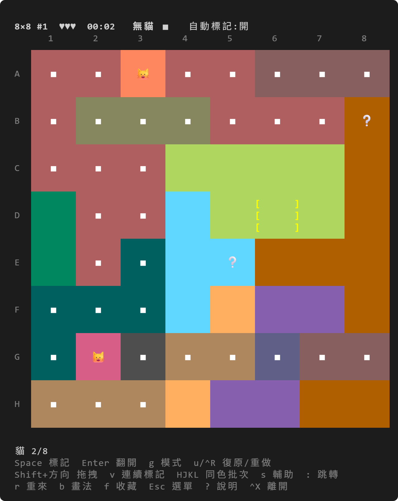

# meowdoku-cli

Meowdoku 的終端機版本。只用 Python 3 標準函式庫（`curses`），不需要安裝任何套件。



規則：n×n 的盤面分成 n 個顏色區塊，每一行、每一列、每個顏色都剛好有一隻貓，而且貓不能相鄰（斜角也不行）。每一關都只有唯一解。

## 來源

- 遊戲原型是手機遊戲 Meowdoku。因為 app 版廣告太多，[yocox/meowdoku](https://github.com/yocox/meowdoku) 做了網頁版的復刻，[plko/meowdoku](https://github.com/plko/meowdoku) 是它的 fork。
- 這個專案是 plko/meowdoku 的終端機版。規則、關卡格式、配色、星數與難度分析的規則都參考它。
- 關卡不包含在這個 repo 裡：第一次執行時才從 plko/meowdoku 的 `levels/bundle/` 下載，並用 sha256 驗證。
- 隨機出題的出題器（`meowdoku/generator.py`）移植自上游的 `tools/generate.py`。推理檢查器則依照上游難度分析器的規則重新實作。

## 安裝

```sh
ln -s "$PWD/bin/meowdoku" ~/.local/bin/meowdoku   # 不需要安裝，直接 symlink
# 或
pipx install .
```

## 執行

```sh
meowdoku               # 主選單
meowdoku 10            # pack 10 的選關畫面
meowdoku 10 42         # 直接玩 pack 10 第 42 關
meowdoku --random 10    # 現場產生一題 10×10
meowdoku --seed 12-5f3a9c21   # 用關卡代碼重現隨機出的關卡
meowdoku fav            # 收藏的關卡
meowdoku --file level.txt
```

第一次執行時會從原 repo 下載關卡，快取在 `~/.cache/meowdoku/`；通關紀錄、最佳時間和未完成關卡的存檔都在 `~/.local/share/meowdoku/progress.json`。遊戲中按 `f` 收藏的關卡存在 `~/.local/share/meowdoku/favorites/`，一關一個檔，格式和 `--file` 相同。

| 參數 | 說明 |
|---|---|
| `--update` | 重新下載關卡清單 |
| `--levels-dir DIR` | 使用本機的 bundle 目錄（例如原 repo 的 `levels/bundle/`），不下載 |
| `--ascii` | 只用 ASCII 符號 |

遊戲中按 `?` 查看熱鍵。除錯時可以設定 `MEOWDOKU_KEYLOG=檔案路徑`，程式會把收到的每個按鍵和造成盤面變化的按鍵記錄下來。設定 `MEOWDOKU_PALETTE=0` 可以讓程式不修改終端機的調色盤。規劃與設計決策見 [PLAN.md](PLAN.md)。

## 測試

```sh
python3 -m unittest
```
